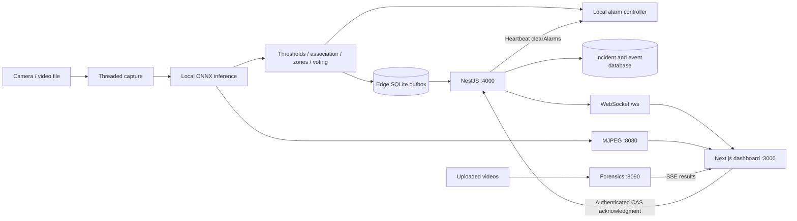

# ARGUS AI / Factory Safety AI — complete project review

**Reviewed:** 2026-10-09. **Repository:** `C:\hackthon-2`. **Revision:** `b3812db` plus the existing working-tree files.

## 1. Assessment and scope

The project has a substantial prototype: real ONNX model artifacts, a Python vision pipeline, a SQLite outbox, a modular NestJS backend, a rich Next.js dashboard, and a separate video-forensics service. Its intended architecture is coherent: detect locally, sound an edge alarm independently of the network, synchronize incidents to the on-premises server, and let supervisors acknowledge them.

**The implementation does not yet establish a reliable end-to-end safety system.** Several critical interfaces disagree, many dashboard controls use local demonstration data, and some performance claims come from generated constants rather than measurements. Compilation and the small existing unit suite pass, but isolated probes reproduce failures in alarm ordering, CAS enforcement, incident deduplication, event delivery, authentication, camera monitoring, and deployment.

This review covers the edge worker, ML/data preparation and model artifacts, server modules and schemas, dashboard routes and state, API proxies, forensics, copilot, infrastructure, documentation, and available tests. It traces the main workflows step by step and supplies a repair sequence. It does not claim to have re-trained models, re-evaluated the full image dataset, tested real CCTV/GPIO, or run a production deployment.

Application code, models, existing databases, service configuration, and credentials were not changed. Pre-existing and concurrent documents were preserved. New audit artifacts and project-memory corrections are the deliverables.

## 2. Evidence levels

| Label | Meaning |
|---|---|
| Verified check | A command or isolated probe was actually executed in this review |
| Source-confirmed | The behavior follows directly from inspected implementation; no live deployment claim |
| Historical claim | Recorded in previous documents or changelog; not re-established here |
| Unverified | Requires hardware, a compatible inference runtime, a running stack, or additional data |

The installed versions observed were Node 24.15.0, npm 11.12.1, Next.js 15.5.25, React 19.3.0, NestJS core 11.2.5, Prisma client 6.19.3, and TypeScript 5.9.3. These are local installed versions, not inferred from dependency ranges.

Read-only HTTP probes on ports **3000, 4000, 8080, and 8090 all returned connection refused** after the sandbox restriction was removed through the tool's escalation mechanism. Earlier “Running” entries are historical, not evidence of current availability. Ports were not changed and services were not started.

## 3. Project map

| Area | Responsibility | Main files | Review outcome |
|---|---|---|---|
| Root | Context, instructions, scripts, documentation | `brain.md`, `AGENTS.md`, `package.json`, `README.md` | Useful context; several claims and startup instructions have drifted |
| `edge/app` | Capture, inference, decisions, local alarms, reliable delivery | `main.py`, `stream.py`, `infer.py`, `postprocess.py`, `alarm.py`, `outbox.py`, `heartbeat.py` | Main pipeline exists; safety and configuration defects remain |
| Edge preview | Annotated MJPEG and snapshots | `mjpeg.py` | Route mismatch with UI and single-client server bottleneck |
| Video forensics | Uploaded-video inference and streaming results | `forensics_server.py` | Separate real inference path, with model/scoring/resource limitations |
| `edge/tests` | PPE association, voter, cooldown | Three pytest files | 7 tests pass; coverage is narrow |
| `server/src` | Authentication, incidents, configuration, events, reports, health | Eleven imported Nest modules plus event bus | Most APIs implemented; critical contracts need correction |
| `server/prisma` | Persistence model and seed data | SQLite/PostgreSQL schemas, `seed.ts` | Provider representations differ; production path incomplete |
| `web/app` | Supervisor UI and Next API routes | Wall, alerts, history, reports, admin, health, forensics, copilot | Mix of actual integrations and local demonstrations |
| Web state/realtime | Alert store, selectors, socket lifecycle, audio | `alerts.store.ts`, `wsClient.ts`, `audio.ts` | Contract, hydration, ordering, and state-transition gaps |
| `ml` | Dataset mapping, augmentation, training, export, reports | `safety_pipeline.py`, Colab scripts, oversampler, sources catalog | Training code exists; baseline eval/bench commands are simulated |
| `models` | Exported detector artifacts | `best.onnx`, `best_s2.onnx` through `best_s5.onnx` | Five distinct files verified; deployment selection is inconsistent |
| `infra` / Dockerfiles | Container packaging | Compose and three images | Multiple startup/configuration blockers; no container run verified |
| `docs` / `audit` | Requirements and historical analysis | PRD, architecture, training, prior audit | Requirements help define acceptance, but old PASS claims are not current proof |

The root development command starts the web and server only. Edge and forensics are separate processes.

## 4. Intended architecture and invariants

This diagram shows the intended boundaries. The current critical path performs snapshot/outbox persistence before calling the alarm, and the UI/server contracts do not yet support all of these arrows correctly.

| Required invariant | Current evidence |
|---|---|
| Alarm has no cloud dependency | No cloud request is required by the edge alarm path; disk failure can still prevent activation |
| Local alarm triggers within 10 ms | Not measured; snapshot/SQLite work precedes it, and the default controller has no configured relay |
| Ports remain 3000/4000/8080 | Preserved; forensics is separately configured on 8090 |
| `OPEN → ACKNOWLEDGED → RESOLVED/FALSE_ALARM` with CAS | Missing version is accepted; direct OPEN-to-terminal transitions are allowed |
| Physical clear only follows supervisor acknowledgment via heartbeat | ID deduplication/retrigger defects remain; worker shutdown also calls `silence()` directly |

## 5. Full workflow, step by step

### Step 1 — Read configuration and choose operating mode

`load_config()` reads a local JSON file or returns Pydantic defaults. Defaults select **two synthetic cameras**, Stage 5 ONNX, 60-second cooldown, and the prescribed server/preview ports. Docker-provided model/server variables are not consumed by this loader. Invalid JSON falls back to defaults.

There should be an explicit distinction between demonstration and operational mode. Currently, missing model files or inference import failures silently select the mock detector. A running process therefore does not establish that real detection is active.

### Step 2 — Construct and start edge subsystems

`EdgeWorker` creates the outbox, temporal voter, cooldown manager, detector, heartbeat client, camera readers, and snapshot directory. It starts delivery and heartbeat threads, capture threads, and the MJPEG server, then enters one inference loop over all cameras.

Capture is threaded; inference is sequential across cameras. Camera capacity must therefore be measured from aggregate processing time, not assumed from a single-camera frame rate. The core loop has no broad fault isolation around each camera's processing path.

### Step 3 — Acquire a frame

`VideoStreamReader` maintains the latest captured image and reconnects RTSP/file sources. Synthetic sources generate factory-style preview frames. Camera health must distinguish a fresh camera frame from a cached frame and from a generated demonstration frame; current heartbeat data does not do this.

### Step 4 — Run the detector

The ONNX engine prepares 640×640 RGB normalized input, executes the model, and decodes legacy/raw or embedded-NMS outputs. Per-class thresholds filter detections. The shipped factory exposes ONNX and mock implementations; the documented `OpenVINOEngine` is not implemented in the current file.

Five ONNX artifacts exist. Stage 5 metadata inspection found input `[1,3,640,640]`, output `[1,300,6]`, float32 boundary tensors, and an NMS node. Model weights may use lower precision internally; a filename or “FP16” label does not determine the input dtype. Real inference speed and accuracy were not re-measured because the available native runtime was incompatible.

### Step 5 — Check fire and smoke

The worker evaluates fire/smoke across the whole frame and uses configured temporal voting, defaulting to 2 positives in a 5-frame window. This is a decision rule, not a guarantee of 200 ms elapsed response: actual frame freshness, inference throughput, and scheduling determine elapsed time.

When the voter fires, the worker creates a persisted incident if the cooldown allows it, then calls the alarm. During cooldown it still calls the alarm, but may supply no alert ID. This produces acknowledgment/retrigger ambiguity.

### Step 6 — Apply zones and associate PPE with people

The worker retains detections whose centers fall inside each configured polygon. Restricted-zone cigarettes use 4/8 voting. PPE association uses person geometry and anatomical regions, then votes over missing-PPE observations with an 8/10 default.

An isolated geometric probe showed that PPE vertically outside a person's box can be accepted because some association bounds are incomplete. The real ONNX detections also do not provide stable person track IDs; the fallback list index is used as identity for temporal history. Reordering or disappearing people can contaminate histories. PPE confidence is emitted as a constant `0.88`, rather than a calibrated violation confidence.

### Step 7 — Activate the local alarm

The intended physical path is local and independent of the server. The current order is wrong for that guarantee: `_emit_alert()` performs directory creation, JPEG saving, and SQLite enqueueing before `trigger_critical()`.

An injected storage exception produced **zero alarm calls**. The singleton uses `relay_pin=None`; `enable_sound` is not wired to a sound device. Thus the default path logs activation but is not a verified physical siren implementation. No real relay was activated or timed in this review.

### Step 8 — Persist and retry the event

The outbox uses SQLite with a primary-key ID and INSERT OR IGNORE, then a background worker retries pending events and uploads snapshots. This is a sound starting point for offline delivery.

However, it marks any HTTP 200/201 as delivered without interpreting the returned canonical incident ID. Its fallback changes the URL path on the same host; it does not independently switch from port 4000 to port 3000 as some comments claim. Delivered rows and edge snapshots lack a complete retention policy.

### Step 9 — Authenticate and ingest on the server

The edge guard hashes a presented key and looks for a node; a configured/development shared-key fallback also exists. Ingestion accepts JSON or multipart, normalizes some snake_case/camelCase fields, checks duplicate UUIDs, and applies secondary incident deduplication.

The authenticated node is not used to enforce camera ownership. A probe submitted an alert for another node's camera successfully. Snapshot filenames incorporate an unchecked alert ID; a safe scratch-only probe wrote a JPEG-named file outside the configured storage subdirectory.

### Step 10 — Save the incident and durable event

An alert row contains camera, severity, type, items, confidence, vote string, timestamps, status/version, snapshot path, and acknowledgment metadata. `AlertEvent` supplies a replay sequence.

Initial ingestion saves the alert and event in separate operations. If event insertion fails after the alert commits, retry returns `already_exists` and does not repair the missing event. The isolated database probe reproduced a persisted alert with **zero replay events**. The transition path is stronger: it groups the alert update, event, and audit entry in a transaction.

### Step 11 — Broadcast and reconnect

The gateway broadcasts event envelopes and can replay events after `?since=<seq>`. It sends keepalive messages and requests a resync when its replay cap is reached.

The most immediate live-delivery failure is dependency wiring: Edge, Alerts, Health, and Realtime each provide their own `EventBusService`. A real Nest application-context probe found **four distinct buses and zero Edge-to-Realtime deliveries**. Thus current producers do not reach the live gateway at all; replay reads the database independently.

There is also no WebSocket authentication check. Clients are enrolled for live events before replay completes; a controlled gateway probe delivered sequence 2 before sequence 1. That ordering defect becomes operational after the disconnected buses are repaired. The web client omits `since=0`, does not hydrate alerts through REST, and its resync reset is rejected by the store's monotonic cursor setter. These are not a gapless recovery protocol yet.

### Step 12 — Render the supervisor dashboard

The application has a developed visual shell, severity controls, alert queue/drawer, video wall, charts, forms, and browser audio. The store seeds demonstration alerts on application mount.

Server events contain uppercase status and, under SQLite, a JSON string for `items`. The UI expects lowercase status, an array of items, and additional fields such as `ts` and `sector`. The client casts the raw payload to the UI type without normalization. A genuine-source in-memory probe showed the received incident disappearing from the active queue and `items.join` throwing.

### Step 13 — Authenticate and acknowledge

The backend has bcrypt login and JWT/cookie authentication, but the login page only navigates to `/wall`; it does not call the login API. The app layout does not implement an authentication gate.

The drawer sends a PATCH with a version, but network failure is treated as success and updates local state. Other alert-card actions are local store mutations. Successful drawer responses are not used to update the returned authoritative version. A browser can therefore appear acknowledged or resolved while the server and edge alarm remain unchanged.

### Step 14 — Enforce CAS and record the action

When supplied, the version participates in an atomic conditional update, and a mismatch returns conflict. The implementation has a useful transactional foundation.

It lacks runtime enforcement of the required version. With `expectedVersion` omitted, Prisma omits that filter and accepts the change. The transition table also permits resolve/false-alarm directly from OPEN. Both behaviors were reproduced against isolated SQLite and violate the repository's required workflow.

### Step 15 — Clear the physical alarm through heartbeat

The edge posts telemetry every configured interval. The server returns canonical IDs of acknowledged or terminal incidents for that node; the controller removes matching IDs and may silence the relay.

Secondary deduplication maps edge ID B to incident A but does not retain B. If the local alarm tracks B, acknowledging A cannot clear B. A retry of B also increments the hit count again. The probe showed `clearsA=true`, `clearsB=false`, and a repeated B producing a third hit.

Heartbeat camera records are always marked online with `frameAgeMs=33`, and the server replaces missing capture timestamps with current time. An active worker can hide a failed camera from the stall detector. CPU/RAM/temperature values in this heartbeat are fixed examples.

### Step 16 — Configure cameras, zones, thresholds, and models

Backend endpoints exist for camera edits, zone creation/deletion, thresholds, voter parameters, and model activation. The edge heartbeat has an optional configuration callback, but `EdgeWorker` does not supply it or fetch/apply the configuration. The server's field names also differ from `EdgeConfig` and need an adapter.

The frontend camera/zone/threshold forms operate on local state or display save toasts. The two missing links are independent: wiring the UI alone will not reload the edge, and adding an edge callback alone will not persist the UI edits. Backend model activation additionally deactivates existing models before validating the replacement; an invalid ID left zero active models in the probe.

### Step 17 — Reports, health, history, and retention

The server provides compliance CSV and count aggregates. The UI's history uses the in-memory alert store; reports largely use fixed arrays and local exports; the health page shows fixed telemetry and acceptance gates.

A true PPE-compliance percentage needs observations of compliant and noncompliant workers/exposures, not just incident counts. That measurement denominator is not established by these alert aggregates.

The server retention task deletes old `AlertEvent` records only. It does not implement the documented 30-day snapshot or 90-day audit-log cleanup. Snapshot deletion, replay retention, and resync must be designed together.

### Step 18 — Uploaded-video forensics

The dedicated forensics UI posts videos to port 8090, reads SSE events, and displays sampled annotated frames and a final report. The service samples every fifth frame, analyzes at most 600 sampled frames per video, and keeps up to eight representative snapshots.

This path uses Stage 4, while the live edge default selects Stage 5. It counts detected violation classes rather than applying the live person's required-PPE/zone/voter policy. The score can report 100% with no person evidence and does not identify missing vests through absence. Its “smoking in restricted zone” text is not backed by zone input in this API.

Uploads are unauthenticated, read fully into memory, and lack configured request-size/worker limits. Video decoding/inference is synchronous within async processing. The feature is not included as a service in Compose. The older `VideoUploadDetection` wall component is a separate preset/timer demonstration; it should not be confused with this inference service.

### Step 19 — AI safety copilot

The Next route optionally calls Groq with conversation and supplied context. Without the configured key, it streams template/rule-based text. No external model request was made during review.

It is an optional cloud-dependent feature outside the local alarm path. The API lacks its own authentication/rate limit, and its context/fallback includes demonstration facts. Recommendations and reports generated there should identify the actual evidence source and mode rather than claim live telemetry implicitly.

## 6. Highest-priority findings

P1 means a major functional, safety-contract, security, or deployment failure. P2 means a material secondary issue. These are review priorities, not a claim that the system is currently deployed in a factory.

| Priority | Finding and observed consequence | Primary location | Completion criterion |
|---|---|---|---|
| P1 | Disk/SQLite failure can prevent a critical alarm | [main.py:170](C:/hackthon-2/edge/app/main.py:170) | Alarm first; injected storage/network failures cannot prevent local activation |
| P1 | Missing model/runtime switches to fabricated detections | [infer.py:176](C:/hackthon-2/edge/app/infer.py:176) | Explicit demo mode; operational mode fails visibly without simulated detections |
| P1 | Four independent event buses prevent live delivery | [edge.module.ts:9](C:/hackthon-2/server/src/edge/edge.module.ts:9), [realtime.module.ts:6](C:/hackthon-2/server/src/realtime/realtime.module.ts:6) | One shared provider; real Nest module integration delivers ingestion, transition, and health events |
| P1 | UI login and triage do not establish server-authoritative state | [login page](C:/hackthon-2/web/app/login/page.tsx), [AlertDrawer.tsx:62](C:/hackthon-2/web/features/alerts/AlertDrawer.tsx:62) | Real login/session, server-confirmed actions, visible pending/error state, synchronized version |
| P1 | Raw WebSocket rows violate the frontend Alert contract | [wsClient.ts:49](C:/hackthon-2/web/realtime/wsClient.ts:49) | Shared validated DTO for REST/live/replay; create/update display consistently |
| P1 | Required CAS version and acknowledgment-first workflow are bypassable | [alerts.service.ts:22](C:/hackthon-2/server/src/alerts/alerts.service.ts:22) | Missing/invalid versions rejected; only prescribed transitions allowed |
| P1 | Dedup loses alarm IDs and retry idempotency | [edge.service.ts](C:/hackthon-2/server/src/edge/edge.service.ts), [outbox.py](C:/hackthon-2/edge/app/outbox.py) | Persist edge-ID aliases; retry counts once; ACK clears every linked local ID |
| P1 | Incident/event writes can diverge; replay can regress state | [edge.service.ts](C:/hackthon-2/server/src/edge/edge.service.ts), [realtime.gateway.ts:50](C:/hackthon-2/server/src/realtime/realtime.gateway.ts:50) | Atomic event commit plus ordered snapshot/replay/live handoff and resync |
| P1 | Unauthenticated WebSocket and unchecked edge camera/file boundaries | [realtime.gateway.ts](C:/hackthon-2/server/src/realtime/realtime.gateway.ts), [edge.service.ts](C:/hackthon-2/server/src/edge/edge.service.ts) | Reject unauthenticated sockets, enforce camera ownership, contain/validate snapshot writes |
| P1 | Camera failure can be reported as healthy | [heartbeat.py:62](C:/hackthon-2/edge/app/heartbeat.py:62) | Capture timestamp/sequence and measured status drive stall detection |
| P1 | PPE association can use protection outside the person | [postprocess.py](C:/hackthon-2/edge/app/postprocess.py) | Bounded anatomical association and stable temporal identity verified with adversarial geometry |
| P1 | Admin save/config reload does not reach edge behavior | [main.py:67](C:/hackthon-2/edge/app/main.py:67), [threshold UI](C:/hackthon-2/web/app/(app)/admin/thresholds/page.tsx:34) | Save, version bump, fetch, validation, and applied-version acknowledgment all work |
| P1 | Container startup and edge configuration are broken | [server/Dockerfile:36](C:/hackthon-2/server/Dockerfile:36), [Compose:76](C:/hackthon-2/infra/docker-compose.yml:76) | Fresh deployment starts actual inference with initialized persistence and correct addresses |
| P1 | Acceptance metrics/benchmark are generated examples | [safety_pipeline.py:515](C:/hackthon-2/ml/safety_pipeline.py:515), [safety_pipeline.py:656](C:/hackthon-2/ml/safety_pipeline.py:656) | Reproducible measurements tied to model/data hashes and runtime hardware |
| P2 | Preview route mismatch and serial HTTP server | [StreamTile.tsx:339](C:/hackthon-2/web/features/wall/StreamTile.tsx:339), [mjpeg.py:90](C:/hackthon-2/edge/app/mjpeg.py:90) | Correct URL and at least four concurrent healthy preview clients |
| P2 | History pagination, retention, model activation, and forensics scoring need correction | Backend/edge supporting reviews | Dedicated boundary and failure-path checks pass |

## 7. Dashboard implementation matrix

| Route / feature | Current source behavior | Remaining integration |
|---|---|---|
| `/` | Landing/presentation UI | Claims should match measured capabilities |
| `/login` | Redirects to wall | Login API, session validation, logout and role-aware navigation |
| App layout | Seeds demo incidents and opens socket | Explicit mode, REST hydration, authenticated access |
| `/wall` | Camera grid, canvas simulations, alert queue; optional MJPEG switch | Correct preview URL, real camera inventory/status, distinct live/demo indicator |
| Wall upload | Timed preset detections | Clearly label demo or route to actual forensics |
| `/alerts` / drawer | Local queue and mixed local/PATCH actions | Shared DTO, authoritative mutations, version refresh, conflict recovery |
| `/history` | Client-store filtering and local export | Server pagination/date filters and durable history |
| `/reports` | Static chart arrays and local data | Server-backed metrics with defined denominators and correct export |
| `/health` | Fixed hardware/model numbers and PASS badges | Measured telemetry, detector mode, freshness, model digest, real evaluation report |
| `/admin/cameras` | Local camera table/addition | Persisted CRUD and source validation |
| `/admin/zones` / camera editor | Polygon editing/local save notice | Persisted API schema conversion and edge application |
| `/admin/thresholds` | Sliders and save toast | Validated threshold/voter persistence and rollout feedback |
| `/settings`, `/profile` | Local/presentation controls | Persist preferences/identity only where claimed |
| `/forensics` | Fetch/stream integration with port 8090 | Authentication, model consistency, scoring, limits, deployment |
| `/copilot` | Optional Groq request or local templates | Auth, evidence provenance, explicit online/offline mode |
| `/api/edge/*` | Next-to-Nest proxies | Internal container address, consistent authentication, truthful failure responses |

## 8. Data, model training, and evidence

The unified ontology has 11 classes: person, helmet, head, vest, gloves, boots, no_gloves, no_boots, fire, smoke, cigarette. The sources catalog maps several public dataset formats into these IDs. The pipeline includes download/preparation, degraded-image generation, YOLO training, export, and reports. Separate Colab scripts implement a precision-threshold sweep and balanced-data fine-tuning; an oversampler targets scarce classes.

| Stage | Repository evidence | Interpretation |
|---|---|---|
| Stage 1 | `best.onnx`; historical 15-epoch description | Artifact exists; current accuracy not re-established |
| Stage 2 | `best_s2.onnx`; historical 25-epoch description | Artifact exists; stale docs also describe different schedules |
| Stage 3 | `best_s3.onnx`; historical two-part training | Embedded-NMS deployment work is recorded |
| Stage 4 | `best_s4.onnx` and SWA checkpoint | Historical precision/recall/mAP numbers exist; forensics selects this file |
| Stage 5 | `best_s5.onnx`; precision-sweep and balanced-training scripts | Live edge default selects it; release lineage and metrics need one manifest |

The Stage 5 precision sweep and the Stage 5 balanced fine-tune are distinct procedures. A 95.4% precision claim at one confidence threshold cannot be transferred automatically to a different checkpoint, mixed per-class thresholds, a different dataset, or the entire deployed safety workflow. Precision, recall, mAP, and system event correctness measure different things.

The checked-in class-distribution CSV records **zero cigarette training and validation annotations**, 869 `no_boots` training annotations, and 2,033 `no_gloves` annotations. The current local dataset was separately counted: 12,923 training images, 3,316 validation images, and 582 degraded images; their label files contained 76,543, 19,957, and 2,887 annotation rows respectively. These current counts differ from historical oversampling claims and the saved CSV, so they must not be combined as one dataset snapshot.

`ds/data.yaml` points test at the validation image directory, so it does not establish an independent held-out test split. Fire classification examples are converted to fixed centered 0.9×0.9 boxes in preparation; their localization quality needs validation. The SH17 mapping also needs a semantic check before treating ordinary shoes as safety boots or all heads as bare heads.

Adding a class name to the ontology does not establish a trained detector. Oversampling can increase exposure to existing examples; it does not create independent validation evidence or fill a completely absent class by itself. The current oversampler can reprocess its own generated labels on a second run; reproducibility should be checked before rerunning it.

The most serious evidence issue is concrete: `cmd_eval` constructs acceptance values and PASS verdicts as literals without evaluating the requested model/data; `cmd_bench` draws random latency values. `ml/report.json` and `ml/report/report.json` reflect those generated values. They must be treated as examples, not measured acceptance results. This finding does not imply that every historical Colab result is fabricated; those separate results require their own retained logs and artifact association.

Model release evidence should include: source checkpoint, export arguments, class map, input/output schema, file hash, actual thresholds, validation split identity, per-class precision/recall, corner-case results, and measured target-device latency. Record detector-only latency separately from capture-to-decision, decision-to-relay, and decision-to-dashboard latency.

## 9. Backend API and persistence coverage

| API | Authorization in source | Purpose |
|---|---|---|
| `POST /auth/login`, `POST /auth/logout`, `GET /auth/me` | Login public; me JWT | Issue/clear/check session |
| `POST /edge/alerts`, `POST /edge/heartbeat`, `GET /edge/config` | Edge key | Ingest, monitor, deliver clear/config state |
| `GET /alerts`, `GET /alerts/:id`, `GET /alerts/:id/snapshot` | JWT | Query incidents and evidence |
| `PATCH /alerts/:id` | Supervisor/Admin | Conditional transition and audit |
| `GET /config/cameras`, `GET /config/models` | JWT | Inventory; current camera response exposes stream field |
| Camera PATCH, zone POST/DELETE, thresholds/params PUT, model activation POST | Admin | Configuration changes |
| `GET /reports/compliance` | Supervisor/Admin | JSON/CSV incident report |
| `GET /reports/aggregates` | JWT | Incident counts |
| `GET /health/live`, `GET /health/ready` | Public | Process and database connection checks |
| `/ws` | No authentication enforced | Live events and capped replay |

The schema entities are Site → Sector → Camera, Site → EdgeNode → Camera, camera Zones/Alerts, ModelVersion, ConfigState, AlertEvent, User, and AuditLog. This separation is useful. The service layer currently encodes SQLite JSON as strings; the PostgreSQL schema uses native JSON, arrays, enums, and BigInt sequences. Those representations need a consistent boundary and verified production build.

Health readiness establishes a database connection, not that all required tables, model files, camera feeds, or alarm devices work. No rate limiter/global validated DTO boundary was found. Stream credentials are assigned directly to `streamUrlEnc`; the name does not implement encryption.

## 10. Verification performed and limits

| Check | Result | What it establishes |
|---|---|---|
| Backend TypeScript with installed SQLite client | Passed | Current development source type-checks |
| Web TypeScript, no emit/incremental writes | Passed | Frontend static types compile; casts can still hide protocol errors |
| Existing edge pytest suite | **7/7 passed** | Existing association/cooldown/voter expectations hold in the adapted test runtime |
| Web lint | Failed to complete: ESLint setup/config missing | No clean automated lint result; no packages/config installed |
| Server TypeScript emit into memory | `dist/main.js`, zero errors | Docker CMD points at the wrong compiled path |
| Fresh isolated SQLite service/controller probes | 12 recorded observations | Reproduced CAS, dedup, ownership, snapshot, pagination, activation, event, and replay defects |
| Real Nest dependency-injection probe | Four event buses; zero cross-module deliveries | Confirms live producer/gateway disconnection, without starting an HTTP server |
| Isolated PostgreSQL generated-client type-check | Client generation passed; source failed with **17 errors** | Confirms the production-schema build incompatibility; no database connection |
| Genuine-source web harness with fake socket/audio | Reproduced contract/cursor/version/siren issues | Store/client behavior in memory; not a browser E2E run |
| Edge offline probes with stubs | Reproduced alarm-order, association, telemetry, config, and mock-fallback issues | Deterministic failure paths; no GPIO or network actuation |
| Model file hashes / Stage 5 graph metadata | Verified | Artifact identity/schema; not accuracy or performance |
| Application HTTP availability | All four service ports refused connections | No current local running-stack claim |

The original `.venv` launcher points to an unavailable interpreter. Edge tests were run with bundled Python 3.12 and compatible/preloaded packages rather than a clean reproduction of the project's environment. The native ONNX Runtime extension could not load in that combination. Real inference and full video/hardware testing remain unverified.

`server/test_e2e.js` was inspected but not run against the user's database: it inserts incidents and changes telemetry. Its historical 9/9 result covers a narrow API smoke path. WebSocket/report checks have incomplete assertions, and the alarm check only inspects a heartbeat ID list. It cannot prove browser login, audio, GPIO, adverse storage conditions, or gapless recovery.

PostgreSQL diagnostics and the precise isolated check are retained in the backend supporting review; generating a client is not a database migration or a running-container test. No Docker executable was available for a full image build/run.

## 11. Recommended repair order and acceptance checks

### Phase 1 — Make operation and demonstration modes explicit

1. Require an explicit detector mode; reject missing/corrupt operational models and incompatible runtimes.
2. Give live, stale, disconnected, unknown, and demonstration data distinct UI states.
3. Remove generated acceptance values from operational status and preserve them only as labeled examples.
4. Pin a reproducible runtime and one model release manifest; reconcile Stage 4/5 selection.

Acceptance: a missing model cannot generate plausible incidents; a disconnected backend/camera cannot display healthy/live status; model identity is visible and matches the configured artifact.

### Phase 2 — Protect the local alarm path

1. Allocate the incident identity and trigger the local alarm before snapshot, database, logging, or network work that can block/fail.
2. Configure a real adapter and test its decision-to-output timing on target hardware.
3. Define synchronized/durable incident latch state and clear semantics across cooldown, ACK, recurring hazards, and restart.
4. Correct PPE geometry and use stable identities or explicitly scoped non-tracking voting rules.
5. Publish real capture freshness and per-camera processing/error state.

Acceptance: disk-full/locked-DB/server-down tests do not prevent local activation; a camera stall is detected; only the intended acknowledged incidents clear; reboot/overlap cases are covered. Measure the required 10 ms local output separately from total detection latency.

### Phase 3 — Repair incident contracts and persistence

1. Define one versioned/validated incident DTO for REST, WebSocket live, replay, and frontend storage.
2. Require a positive integer expectedVersion and restrict transitions to the documented state machine.
3. Commit alert/event writes atomically; retain edge-origin IDs and dedup aliases for idempotency and clearing.
4. Share one event-bus provider across Nest modules, authenticate sockets, and establish an ordered snapshot/replay/live handoff with real resync behavior and stale-update rejection.
5. Enforce camera ownership and snapshot storage containment; validate payloads/uploads before writes.

Acceptance: concurrent supervisors yield one winner; missing versions fail; retries do not double-count; every committed incident has a durable event; reconnect restores authoritative state without regression; unauthorized clients cannot subscribe or impersonate cameras.

### Phase 4 — Connect the supervisor workflow

1. Implement login/session/logout and role-aware access using the existing backend.
2. Fetch current incidents on load and make all triage actions use the same authoritative mutation path.
3. Show pending/error/conflict states and apply the returned version; never claim offline acknowledgment succeeded.
4. Fix MJPEG URLs and concurrent serving; connect camera inventory and health.
5. Wire configuration forms, implement the edge config adapter/hot reload, and expose applied configuration version.
6. Connect history/reports to durable server data and define metric denominators.

Acceptance: use an actual browser to login, receive a real edge incident, inspect its snapshot, ACK with CAS, observe heartbeat clearing, resolve, reload, and export the same incident. Include a second supervisor and a disconnected-server case.

### Phase 5 — Make deployment reproducible

1. Fix the server entry point and database-provider compatibility.
2. Add a deliberate schema initialization/migration and bootstrap process.
3. Align edge dependency/configuration/persistent-volume paths.
4. Separate internal container URLs from supervisor-browser LAN addresses and supply frontend build configuration correctly.
5. Package forensics, bound uploads/concurrency, and implement retention.
6. Add a disposable integration environment and CI checks for both supported database paths.

Acceptance: build from a fresh checkout, deploy with empty volumes, restart all services, retain outbox/events, reconnect from another LAN computer, and verify the complete workflow. The current Compose file has not passed this gate.

### Phase 6 — Establish model and capacity evidence

1. Re-run actual validation on frozen clean/degraded/corner-case splits; retain raw predictions and per-class counts.
2. Obtain and label cigarette data before claiming smoking performance.
3. Evaluate PPE event accuracy after association/voting, not just detector mAP.
4. Benchmark simultaneous cameras on the chosen hardware, including p50/p95/p99 latencies, missed frames, disk load, and disconnected operation.
5. Validate uploaded-video scores against known examples, including empty/no-person/no-detection videos and long-video truncation.

Acceptance: every presentation figure links to a reproducible report for the exact deployed model and configuration. Neither the random benchmark nor the fixed acceptance-report generator satisfies this.

## 12. Documentation corrections and retained evidence

Treat historical startup logs and test results as dated observations. Current corrections are recorded in `brain.md`; the original analysis and concurrent user documents were preserved.

Specific claims that need reconciliation include: active Stage 4 versus edge Stage 5; OpenVINO support versus the ONNX/mock factory; “live four-camera” versus two synthetic defaults and simulated UI; hot reload versus an unwired callback; snapshot/audit retention versus event-only deletion; gapless replay versus observed ordering/resync defects; and production-ready deployment versus current build/configuration blockers.

Supporting reviews and reproducible evidence:

- [Edge and ML review](C:/hackthon-2/audit/EDGE_ML_REVIEW_2026-10-09.md)
- [Backend review](C:/hackthon-2/audit/SERVER_REVIEW_2026-10-09.md)
- [Dashboard review](C:/hackthon-2/audit/WEB_REVIEW_2026-10-09.md)
- [Infrastructure review and model hashes](C:/hackthon-2/audit/INFRA_REVIEW_2026-10-09.md)
- [Isolated backend probe source](C:/hackthon-2/audit/server-review-checks.cjs) and [recorded results](C:/hackthon-2/audit/server-review-results.json)
- [Edge offline probe source](C:/hackthon-2/audit/edge_ml_review_probes_20261009.py)
- [PostgreSQL compatibility probe](C:/hackthon-2/audit/server-postgres-review.cjs)
- [PostgreSQL compiler diagnostics](C:/hackthon-2/audit/server-postgres-review-results.txt)
- [Nest module-wiring probe](C:/hackthon-2/audit/server-module-wiring-check.cjs) and [recorded results](C:/hackthon-2/audit/server-module-wiring-results.json)

The immediate engineering priority is a trustworthy camera → local alarm → durable incident → authenticated supervisor → heartbeat clear path. The existing module separation and detector artifacts provide a useful base for that work; the checks above define what remains before its behavior can be claimed as verified.
